

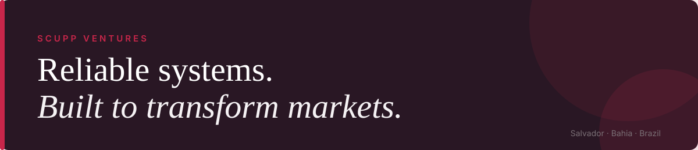

# Carlos Vítor Laurine Pinho

### Senior Site Reliability Engineer &nbsp;·&nbsp; Venture Studio CEO &nbsp;·&nbsp; Applied AI

*Where enterprise reliability meets venture building, convinced that AI only matters when people can trust it in production.*

📍 Salvador, Bahia, Brazil

---

## `01` &nbsp;About

I work at the point where **production reliability**, **applied AI** and **venture building** meet.

- ⚙️ **5+ years in software engineering, 4+ at [Thomson Reuters](https://www.thomsonreuters.com/)**, where I moved from Senior Backend Development to Site Reliability Engineering on the Global Onvio Tax and Accounting platform.
- 🤖 **Co-designing Agentic SRE**, a multi-agent system whose statistical release-risk checks act as gates in the delivery pipeline, always with a human in the loop on the decisions that matter.
- 🧪 **Training and evaluating small models in-house** (Python, PyTorch), with baselines first, out-of-time validation and null results reported.
- 🚀 **Co-Founder & CEO of [Scupp Ventures](https://scuppventures.com)**, a venture studio and R&D ecosystem of ten companies that share technology, knowledge and growth strategy.
- 🎓 **Graduate studies in Applied AI and Software Architecture** (details below), alongside full-time work.

> **How I work:** evidence over enthusiasm. Small experiments before big rollouts, assumptions revisited when reality changes, and technical ideas explained in plain business terms.

**Right now**

- Finishing two postgraduate programs (Applied AI, ends Feb 2027; Software Architecture and Data Science with Cybersecurity, ends Nov 2026).
- Building AI-assisted quality and risk checks for the delivery lifecycle at Thomson Reuters.
- Running a pre-registered study on documentation retrieval and LoRA adapters for code models, null results included.
- Preparing the Portuguese-language model run at SapucaIA (corpus and tokenizer ready) and strengthening the math under the models I use: linear algebra, probability and statistics.
- Preparing the Nexupp app launch on 28 Nov 2026 and the studio's presence at BTX 2026.

**Languages:** Portuguese (native) · English (professional; Duolingo English Test 135) · Italian (limited working) · Chinese (elementary)

---

## `02` &nbsp;Focus Areas

| | |
|---|---|
| **Applied AI & Agents** | Applied AI R&D at [SapucaIA](https://sapucaia.ia.br), LLM-powered agents, multi-step pipelines, MCP, prompt and API engineering, small-model training and evaluation methodology, AI security and governance |
| **Reliability Engineering** | Observability (metrics, logs, traces), incident management, performance and load testing, cloud migrations, cost-aware infrastructure |
| **Backend & Distributed Systems** | Java and Spring Boot microservices, event-driven architecture (Kafka, RabbitMQ), REST APIs, Python services (FastAPI, PyTorch, pandas) |
| **Trusted & Sustainable AI** | Verifiable renewable-energy certification for AI workloads ([RaízesHUB](https://raizeshub.com)), AI-native audiovisual production on local infrastructure ([AleteIA Studio](https://aleteiastudio.com/)) |
| **Venture Building** | Venture-studio strategy, product and platform delivery, partnerships with companies, universities and public institutions |

---

## `03` &nbsp;Experience Snapshot

| Role | Where | Period |
|---|---|---|
| **Senior Site Reliability Engineer** | Thomson Reuters | Jul 2024 – present |
| **Senior Software Developer** (Backend) | Thomson Reuters | Sep 2022 – Jun 2024 |
| **Co-Founder & CEO** | Scupp Ventures | Feb 2020 – present |
| **Mid-Level Backend Developer**, team Security Champion | Invillia (PagSeguro) | Dec 2021 – Oct 2022 |
| **Junior Backend Developer** | Grupo GCB | Sep 2021 – Feb 2022 |

**At Thomson Reuters** I built the first performance, load and disaster tests for a set of microservices, ran observability with Datadog and Kibana, took part in incident and crisis calls, and now work on cloud migrations, observability and AI-assisted quality checks across the delivery lifecycle (AWS and GCP). I am one of the founding engineers of **Agentic SRE**, a multi-agent system that governs the delivery lifecycle: statistical regression detection and release-risk scoring act as hard gates in the pipeline, with agents running on live production telemetry.

---

## `04` &nbsp;Scupp Ventures

> ***One group, many fronts.*** *An ecosystem built to transform markets.*

A venture studio and R&D ecosystem built in Salvador. Each company works in its own market and shares technology, knowledge and connections with the others.

<table>
  <tr>
    <td><a href="https://scupp.com.br">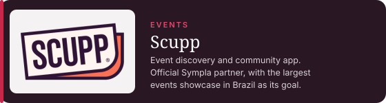</a></td>
    <td><a href="https://nexupp.com.br">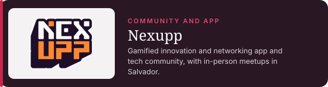</a></td>
  </tr>
  <tr>
    <td><a href="https://sapucaia.ia.br">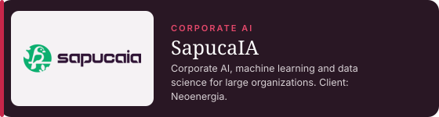</a></td>
    <td><a href="https://raizeshub.com">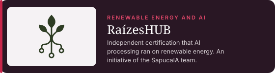</a></td>
  </tr>
  <tr>
    <td><a href="https://svend-webapp.vercel.app/">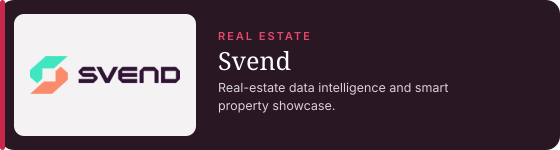</a></td>
    <td><a href="https://shion-lp.vercel.app/">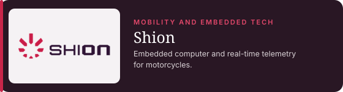</a></td>
  </tr>
  <tr>
    <td><a href="https://spym-lp.vercel.app/">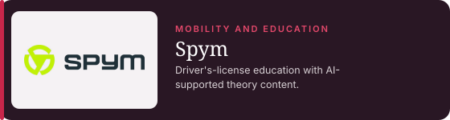</a></td>
    <td><a href="https://aeos.com.br">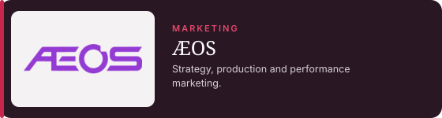</a></td>
  </tr>
  <tr>
    <td><a href="https://runtraining.net.br">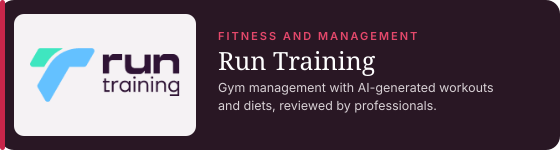</a></td>
    <td><a href="https://aleteiastudio.com/">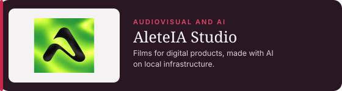</a></td>
  </tr>
</table>

Every card links to the company's site. The full ecosystem is at <a href="https://scuppventures.com">scuppventures.com</a>.

### Where AI meets trust and craft

Three ventures carry the reliability-first view of AI across the whole chain: **the models and evaluation** ([SapucaIA](https://sapucaia.ia.br)), **where the compute comes from** (RaízesHUB) and **what the AI produces** (AleteIA Studio).

| | Venture | What it does | Why it fits |
|---|---|---|---|
| 🧠 | **[SapucaIA](https://sapucaia.ia.br)** *(Applied AI R&D)* | The ecosystem's AI lab. It builds evaluation harnesses, multi-agent data pipelines, specialist small models and a Portuguese-language model roadmap, and delivers proprietary AI for enterprise cases. Selected for *Beta* at Web Summit Rio 2026, and winner of the EGAESE 2026 case award with GEOEX Tecnologias for **Neoenergia**. | Puts "AI only matters when people can trust it in production" into practice: strict evaluation gates before any result moves forward. |
| 🌱 | **[RaízesHUB](https://raizeshub.com)** *(Renewable energy and AI)* | An independent certifier that **measures, records and certifies** that AI processing ran on renewable energy, connecting power generators, data centers and the companies that consume AI. An initiative of the SapucaIA team, supported by Scupp Ventures. | Applies the SRE habit of *proving it with data* to AI's energy footprint, so sustainability claims can be audited instead of just announced. |
| 🎬 | **[AleteIA Studio](https://aleteiastudio.com/)** *(Audiovisual and AI)* | A creative studio that makes **films for digital products with AI**, running on its own infrastructure. It turns the essence of each product into visual narratives with identity, personality and a connection to its audience. | Shows applied AI producing a real, client-facing deliverable, with the same local-infrastructure approach as the rest of the ecosystem. |

### Highlights

- **Web Summit Rio 2026:** took four ecosystem startups to the stage. Scupp, Svend and Run Training exhibited in the *Alpha* category, and SapucaIA was selected for *Beta*, the second-highest qualification tier.
- **EGAESE 2026:** SapucaIA and GEOEX Tecnologias built a proprietary AI model for **Neoenergia** and won the case award. The work spans seven asset-management verticals studied as proofs of concept (inventory, CAPEX, unitization, materials, purchase and distribution planning, copilot), starting with inventory-deviation risk ranking.
- **Prêmio Innpulse Bahia 2026:** Nexupp is a semifinalist in the *Territórios de Inovação* category.
- **Programs:** Google for Startups Cloud, Datadog for Startups, MongoDB for Startups, Founder Institute alumni.
- **Ecosystem:** founding partner of the Startup Acceleration Program at **DOCA1** (Salvador's creative-economy hub). Partnerships with Grupo Alun (FIAP, Alura), AWS Student Builders Group, Sebrae and Darwin Startups. Sponsor of two university tech leagues (LAMIT at UCSAL, LACITE at UNIJORGE).
- **Events and partners:** Nexupp took part as official partner, panelist and exhibitor at **AWS Student Community Day Salvador** (800+ attendees, the largest edition in Brazil at the time), exhibited at **SEMCOMP SENAI CIMATEC 2026.2** with two co-founders on stage, and will run the gamified networking for **BTX 2026** (Bahia Tech Experience) in partnership with Sebrae, with a main-stage talk and a Partner-category stand.
- **Next:** official launch of the Nexupp app on **28 November 2026** at DOCA1.

### Community impact

| Where | Result |
|---|---|
| **Nexupp at DOCA1** (first two months) | ~30 recurring in-person participants per Saturday meetup, 300+ in the WhatsApp community, ~500 organic Instagram followers, mostly university students aged 18 to 26 |
| **LAMIT, UCSal** (academic league supported by Scupp and Nexupp) | 200 at the opening event, 200 in talks with market professionals, 80 students at the Ford Day immersion |
| **LACITE, UNIJORGE** | Scupp is godparent of the first technology and innovation league of the university; the opening filled the auditorium |

---

## `05` &nbsp;Applied AI R&D

Research and engineering tracks at the studio, mostly through [SapucaIA](https://sapucaia.ia.br), the ecosystem's AI lab. The lab runs on its own infrastructure (an NVIDIA DGX Spark with 121 GB of unified memory, plus AWS and GCP), and the emphasis is on **small, specialist models and verifiable pipelines** rather than one giant model for everything.

### Selected work

| Track | What it is | Stage |
|---|---|---|
| **Applied ML for an electric-utility client** | Inventory-deviation risk ranking and six more verticals (CAPEX, unitization, materials, purchase and distribution planning, copilot). Out-of-time validation with no leakage, bootstrap intervals, Wilcoxon tests, logistic-regression and gradient-boosting baselines. In two verticals the simple baseline won, and we reported it. | Proofs of concept on the client's homologation data. Under NDA: no data, metrics or code can be shared |
| **Small models trained in-house** | A ~26M-parameter GPT trained from scratch on records serialized as text; a ModernBERT multi-label event classifier; LoRA adapters on Qwen2.5-Coder; a ~1.8B Portuguese-language model in preparation (corpus and tokenizer ready) | Classifier and GPT in use; the Portuguese model is awaiting its first training run |
| **ossagent** | Supervised code generation: a local model writes the code, a read-only reviewer checks API usage, and an **objective verifier with no LLM** (ruff, pytest, tsc, eslint) decides. A frontier model supervises and takes over on escalation. Every run is traced in Langfuse and logged to a ledger | In daily use, with hundreds of logged runs; a self-improvement loop is under construction |
| **datalens** | Multi-agent pipeline that infers table semantics and relationships in undocumented schemas: a deterministic profiler first, then agents, then an adversarial critic that checks every proposal against the data | In active development |
| **Retrieval and LoRA study** | Does documentation retrieval help specialized code models? Pre-registered plan and decision rules. A fine-tuned dense retriever did **not** beat BM25 under the pre-registered rule, and that null result is reported | Research project in progress |
| **Local AI platform** | A lease arbiter for the single large-model slot (large models cannot coexist in unified memory); measured serving notes (active parameters, not quantization, dominated decode speed; structured-output adherence went from 0% to 95% with the right parser flag); and a documented, closed failed attempt that ended in an out-of-memory reboot | Operating lab |
| **Speech to minutes** | Voice activity detection, WhisperX transcription and pyannote diarization, then minutes drafted by an LLM and **audited against the transcript** in a second pass | Running for the studio |
| **Auditable AI energy use ([RaízesHUB](https://raizeshub.com))** | An independent layer that measures and records the energy behind AI processing and certifies when it came from renewable sources. Includes a unit-economics model with a published sensitivity analysis showing the original resale margin does not close at current assumptions | MVP prototyping |
| **AI-native production ([AleteIA Studio](https://aleteiastudio.com/))** | Generative video pipelines for digital-product films, running on local infrastructure | In operation |

All of this work is covered by non-disclosure agreements, so this profile documents the method instead of the code.

---

## `06` &nbsp;How I Evaluate AI Systems

The habits I bring from reliability engineering into model work:

- **Baselines first.** A new model has to beat logistic regression and gradient boosting before it earns a place.
- **Out-of-time validation, no leakage.** History strictly in the past; the outcome is never a feature.
- **Intervals and tests, not point estimates.** Bootstrap and rank tests before any claim of improvement.
- **Decide before you look.** Pre-registered plans and decision rules, so the result cannot rewrite the question.
- **Report null results.** A retriever that fails its pre-registered test goes in the write-up.
- **Verifiers over self-judgment.** Objective checks (compilers, tests, linters) decide; the model does not grade itself.
- **Fail closed.** If the data cannot support a figure, the pipeline withholds it instead of inventing one.
- **Real data or a label.** Synthetic data is declared as synthetic, and every unsourced input is a labeled hypothesis, not a projection.
- **Write the decision down.** Every relevant decision goes into a decision log.
- **Say what is noisy.** After finding a data-loader race that made training runs non-reproducible, I fixed it and flagged that earlier results carry more noise than I had assumed.

---

## `07` &nbsp;Tech Stack

**AI & Data**

**Reliability, Observability & Cloud**

**Backend & Data Stores**

**Web & Tooling**

---

## `08` &nbsp;Education

| Program | Institution | Status |
|---|---|---|
| **B.Sc. in Software Engineering** | Universidade Católica do Salvador (UCSal) | Graduated Oct 2024 (overall average 8.94/10) |
| **Postgraduate (lato sensu): Software Engineering in Applied AI** | UNIPDS / Centro Universitário Anhanguera Pitágoras Unopar, Niterói | In progress, ends Feb 2027. 11 of 15 courses done, all 100/100 |
| **Postgraduate (lato sensu): Software Architecture and Data Science with Cybersecurity** | PUCPR | Ends Nov 2026. Applied project approved (9.70/10) |
| **Founder Institute** | Startup environment, innovation and entrepreneurship | Graduate, 2023 |

**Relevant coursework (B.Sc.):** Artificial Intelligence (10.00/10), Data Structures, Algorithms, Discrete Structures and Logic, Probability and Statistics, Calculus I, Computer Architecture, Operating Systems, Computer Networks, Distributed Systems, Compilers, Databases.

**Certifications:** Duolingo English Test 135 · Decoder Bootcamp: Microservices Architecture with Java and Spring (330 h) · JMeter: Performance and Load Testing · REST APIs with Spring Boot, JPA and PostgreSQL.

---

## `09` &nbsp;Writing and Research

- **Nexupp: Secure and Scalable Architecture for Gamified Networking at In-Person Events** (postgraduate final project, PUCPR, 2026; approved 9.70/10). An audit of an MVP and a secure, LGPD-compliant target architecture with a 16-week plan to a pilot, including SLOs, a DevSecOps pipeline and a risk matrix.
- **Microservice Architecture Versus Monolithic: an Empirical Feasibility Analysis with Performance Tests and a Case Study** (undergraduate thesis, UCSal, 2024).
- **Research internships (UFBA, 2018):** Nuclear Physics Institute (scanning electron and atomic force microscopy on fluorine-doped tin oxide films for solar-energy conversion) and the Optic Properties Lab (an early-stage method to detect soil nematodes).

---

## `10` &nbsp;GitHub

### Public repositories

Most of my AI, reliability and Python work is private. What is public today is the earlier Java and Spring Cloud work:

| Repository | What it shows |
|---|---|
| [E-Learning platform, microservices](https://github.com/CarlosLaurine?tab=repositories&q=E-LearningPlatform) | A Spring Cloud reference architecture: service registry, config server (with its properties repository), API gateway, and domain services for users, courses and notifications |
| [Complete DS Catalog App](https://github.com/CarlosLaurine/Complete-DS-Catalog-App) | A Spring Boot REST application with a catalog domain |

<!-- Add here, once published: a small public project in Python with its pre-registration or evaluation notes, linked from Featured on LinkedIn. -->

Cards and snake refresh daily via GitHub Actions.

---

**Open to conversations on agentic AI, reliability engineering, venture building and innovation in Brazil and beyond.**

